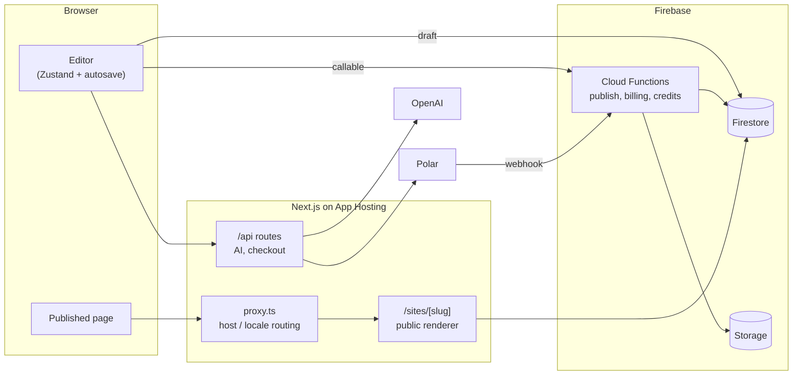

# Milestis

**A web editor for turning photos into shareable interactive pages: portfolios, photobooks and restaurant menus, published by link or QR code.**

Milestis was a solo startup I built and ran in 2025–2026: product, design, frontend, backend, billing and operations. The product is no longer running and all production services have been shut down. The repository is published as-is, with its full commit history, as a record of the work.

> **Status:** discontinued. There is no live demo, and the code will not run without your own Firebase, Polar and OpenAI accounts.

<!-- Screenshots / demo video go here -->

## What it does

Users pick a project type, add photos and text in a visual editor, and publish the result as a standalone page.

| Project type | Published as | Access |
| --- | --- | --- |
| **Portfolio** | Subdomain: `{slug}.<pages-domain>` | Public |
| **Photobook** | `/<slug>?share=TOKEN` | Private, by link with a token |
| **Restaurant menu** | Subdomain plus extra pages (`/drinks`) and a QR code per page | Public while the menu plan is paid |
| **Event** *(hidden in the UI)* | `/<slug>?share=TOKEN` | Private, guests upload photos anonymously |

Other features:

- **AI assistant in the editor.** It generates and edits text and layout. For menus it builds categories, dishes, prices and pages from pasted text or a photo of a paper menu, and it can restyle dish photos.
- **Credits and subscriptions.** Purchases, subscriptions and webhooks go through Polar. Credits are spent on publishing, and menus have their own monthly billing with auto-renewal.
- **Templates and themes.** Each mode has several templates, color palettes, typography and motion effects.
- **Guest experience for menus.** Guests can build an order list that persists across pages, see recommendations and play a small mascot game.
- **Admin panel** for credit compensations, gated by a custom claim.
- **Three locales:** English, Russian and Kazakh.

## Tech stack

| Layer | Technology |
| --- | --- |
| App | Next.js 16 (App Router), React 19 with React Compiler, TypeScript |
| UI | Tailwind CSS 4, shadcn/ui and Radix, Motion, Swiper, Vaul |
| State and data | Zustand (editor), TanStack Query |
| i18n | next-intl (`en`, `ru`, `kz`) |
| Backend | Firebase Cloud Functions, Firestore, Cloud Storage, Auth, App Check |
| Hosting | Firebase App Hosting |
| Payments | Polar (checkout, subscriptions, signed webhooks) |
| AI | OpenAI Responses API with strict JSON schemas, Images API |
| Moderation | Google Cloud Vision SafeSearch |

## Architecture



The repo holds two independent packages: the Next.js app at the root and Firebase Functions in [`functions/`](functions/). Pure domain types and validators live in [`functions/src/domain/`](functions/src/domain/) and are shared by both packages, so the client and the server validate content with the same code.

### Notable engineering decisions

- **Draft and published snapshot are separate.** Autosave writes only the working draft (`projects/{id}/data/content`). Publishing produces a separate public snapshot (`published_projects/{id}`) and copies only the media it uses into public storage. Editing a draft never breaks a live page.
- **Transactional credit ledger.** [`functions/src/transactions/engine.ts`](functions/src/transactions/engine.ts) updates the balance, credit lots with expiry dates, history and an idempotency record in a single Firestore transaction. Credits are spent subscription first, then bonus, then purchased, with the soonest-expiring lot first within each source. A retried request with the same key returns the original result, and the same key with different parameters is rejected. Polar webhook redelivery therefore never grants credits twice.
- **Server-side slug reservation.** Slugs are validated against a policy and reserved inside the publish transaction. A slug stays reserved after unpublishing.
- **Multi-host routing.** [`src/proxy.ts`](src/proxy.ts) serves the app and user pages from different hosts and maps subdomains and paths to the public renderer. Private share tokens are stored and checked as hashes.
- **Pluggable editor modes.** Portfolio, photobook, event and menu each implement a mode contract in [`src/editor/lib/modes/`](src/editor/lib/modes/) for content shape, save, restore and templates. Adding a mode does not touch the editor core.
- **Safe AI edits.** The server owns the prompts, models and JSON schemas. Every response is checked against its schema and the shared domain validator. A response is applied only if the draft version has not changed since the request, so a slow AI reply cannot overwrite a manual edit. Usage is rate-limited per user, per minute and per day.
- **Generated configuration.** `npm run configure` generates environment-specific files from a single source and `check:config` checks that they agree, so the app and Functions stay in sync.

## Repository layout

| Path | Contents |
| --- | --- |
| `src/app/[locale]/` | Marketing pages, auth, dashboard, editor |
| `src/app/api/` | Server routes (AI, checkout) |
| `src/app/sites/[slug]/` | Public renderer for published projects |
| `src/editor/` | Editor core, modes, image pipeline |
| `src/lib/ai/` | AI contracts and server execution |
| `functions/src/projects/` | Create, publish, republish, menu billing, events, deletion |
| `functions/src/transactions/` | Credit engine, admin operations, Polar webhooks |
| `functions/src/users/` | Profiles, subscriptions, referrals, data export |
| `messages/` | Translations (`en`, `ru`, `kz`) |
| `firestore.rules`, `storage.rules` | Security rules |
| `scripts/`, `tests/` | Config generation, checks, test infrastructure |

## Running it locally

You need Node.js 24 plus your own Firebase project, and optionally Polar (use sandbox) and OpenAI accounts.

```bash
npm ci
npm --prefix functions ci
cp .env.example .env.local   # fill in your own values
npm run configure
npm run dev
```

The app runs on `localhost:3000` and published pages on `pages.localhost:3000`. [`apphosting.yaml`](apphosting.yaml), [`.firebaserc`](.firebaserc) and [`storage-cors.json`](storage-cors.json) contain placeholders. `npm run configure` regenerates them from your `.env.local`.

Detailed setup, configuration and deployment guides are in [`docs/`](docs/) (in Russian):

| Topic | Document |
| --- | --- |
| Local setup | [getting-started.md](docs/handoff/getting-started.md) |
| Environment variables and domains | [configuration.md](docs/handoff/configuration.md) |
| Firebase, Polar, secrets, DNS, deploy | [services-and-deploy.md](docs/handoff/services-and-deploy.md) |
| Architecture and checks | [architecture-and-checks.md](docs/handoff/architecture-and-checks.md) |
| Restaurant menu, publishing and billing | [menu.md](docs/menu.md) |
| AI in the editor | [ai-editor.md](docs/ai-editor.md) |
| Admin credit tools | [admin-credits.md](docs/admin-credits.md) |

## Tests and checks

The tests use Node's built-in test runner and mock every external service.

```bash
npm run test        # unit and integration tests
npm run lint        # app ESLint
npm run typecheck   # Next.js typegen + tsc
npm run check       # config, both linters, tests, both builds
```

The tests cover the credit engine, admin operations, slug policy, menu billing and publishing, public menu routes, AI editor contracts and editor reliability.

## Lessons learned

- **The architecture took most of the time.** Once the data model, the draft and snapshot split, and the credit ledger were right, new modes and features came quickly.
- **Shipping less is faster.** The features that mattered were editing, publishing and payments that never lose money. Much of the rest could have waited.
- **A startup is mostly not code.** As a solo founder I also handled the company, taxes, legal policies, support and operations. That showed me I most enjoy building the product itself.

## License

<!-- Choose a license: MIT, or "All rights reserved" if the code is for viewing only. -->
